# pele-layout-circular

A circular layout for Pele flowcharts.

[Pele](https://pele.run) draws mermaid diagrams as SVG. mermaid is a
language for writing diagrams as text. Pele reads that language, is
smaller than mermaid, and runs without a browser. Obsidian uses it to
draw diagrams in notes.

This package adds a circular layout to Pele's flowcharts. A layout
decides where each box goes and the path each arrow takes. With this
one, the nodes sit at even spacing on a circle, called the ring. Each
arrow follows the circle to the next node.

In Obsidian, use the
[obsidian-mermaid-circular](https://github.com/AndrewBroz/obsidian-mermaid-circular)
plugin instead.


Pick the layout in the diagram's frontmatter. That is the settings
block between two `---` lines at the top of the diagram.

```
---
config:
  layout: circular
---
flowchart LR
  E[Evaporation] --> C[Condensation]
  C --> P[Precipitation]
  P --> R[Runoff]
  R --> O[Collection]
  O --> E
```

Pele's own layout draws the same text like this:


## Which package to use

The same circular layout comes in four packages. Pick the one that
matches how you draw diagrams.

| You draw diagrams with | Use |
| --- | --- |
| mermaid, in a web page or app | [mermaid-layout-circular](https://github.com/AndrewBroz/mermaid-layout-circular) |
| Pele, in a web page or app | this package |
| Obsidian, in your notes | [obsidian-mermaid-circular](https://github.com/AndrewBroz/obsidian-mermaid-circular), a plugin |
| your own code | [layout-circular](https://github.com/AndrewBroz/layout-circular), the shared placement math |

The first three use layout-circular to decide where each node goes.
They place nodes the same way. They differ in how boxes and text are drawn.

## Install

```sh
npm install pele pele-layout-circular
```

Register the wrapped flowchart once, before rendering:

```ts
import { register } from 'pele';
import flowchart from 'pele/diagrams/flowchart';
import { withCircularLayout } from 'pele-layout-circular';

register(withCircularLayout(flowchart));
```

Diagrams without `layout: circular` are drawn by Pele as before.

Works with Pele 1.13 and later.

## Write a circular diagram

`layout: circular` places the nodes clockwise, starting at the top.
`layout: circular-ccw` places them counter-clockwise.

Every other flowchart feature works as Pele draws it: node shapes,
edge labels, styles and classes. Pele takes its colours from its
`--pele-*` CSS variables, and circular diagrams use them the same way.

## Straight edges

By default, an arrow between two neighbours on the circle is curved
along it. Set `flowchart.curve` to `linear` to draw straight lines
instead, so the ring becomes a polygon.

An arrow between two nodes that are not neighbours is called a chord.
A chord is always a straight line across the circle. When two straight
arrows join the same two nodes, they are drawn as parallel lines, each
with its label on its own side.

| Curved arrows (the default) | `curve: linear` |
| --- | --- |
|  |  |

```
---
config:
  layout: circular
  flowchart:
    curve: linear
---
flowchart LR
  W[Wake] -->|coffee| Wk[Work]
  Wk -->|lunch| M[Meetings]
  M -->|escape| F[Focus]
  F -->|dusk| Hm[Home]
  Hm -->|sleep| W
  Wk -.->|skip the day| Hm
```

## Groups

| A small group: a box | A group around half the ring or more: a band |
| --- | --- |
|  |  |

A subgraph (a group of nodes) keeps its members next to each other on
the circle. A small group is drawn as a tight box. The circle turns, if
needed, so the box clears every other node. A group that covers half
the circle or more is drawn as a band, a strip that follows the
circle. A box around that much of a circle would cover the middle.
When arrows cross the top of a box, its title moves to the bottom.

A band keeps the group's class, `data-id` and fill, so your CSS still
applies.

More group examples are in the [gallery](docs/GALLERY.md#groups).

## More shapes

<table>
<tr>
<td align="center"><br>Branches hang off the ring</td>
<td align="center"><br>A hub goes in the middle</td>
</tr>
<tr>
<td align="center"><br>A wheel: a ring around a hub</td>
<td align="center"><br>A cycle off the ring gets its own circle</td>
</tr>
<tr>
<td align="center"><br>Two cycles sharing a node: a figure-eight</td>
<td align="center"><br>Cycles linked in a chain, each turning the other way</td>
</tr>
</table>

A branch is a node that hangs off the ring, pointing outward. A hub is
one node linked to most of the others. A satellite is a second, smaller
cycle hanging off the ring, drawn as its own circle.

Each picture's source, and more examples, are in
[docs/GALLERY.md](docs/GALLERY.md).

## Options

The second argument of `withCircularLayout` takes options. For
example, this turns off the hub, so no node moves to the middle:

```ts
register(withCircularLayout(flowchart, { hub: 'none' }));
```

`hub` also takes a node id, which makes that node the hub.

When no option sets it, `spacing` comes from the diagram's
`flowchart.nodeSpacing`. A diagram's own frontmatter wins over options
set in code. `layout: circular-ccw` runs counter-clockwise, and
`curve: linear` draws straight edges, whatever the options say.

This package sets `parallelGap`, the space between two parallel lines,
to 8. Pele's arrowheads are smaller than mermaid's, so the lines can sit
closer.

[All options](https://github.com/AndrewBroz/layout-circular/blob/main/docs/OPTIONS.md)
are listed in layout-circular.

## How it works

Pele has no public way to add a layout. This package wraps Pele's
flowchart. Pele draws the diagram first, then the wrapper moves each
node, label and group to its place on the circle and redraws the
arrows. Details are in [docs/HOW-IT-WORKS.md](docs/HOW-IT-WORKS.md).

A layout hook for Pele is proposed in
[obsidianmd/pele#163](https://github.com/obsidianmd/pele/pull/163).

## Limits

- An arrow that points at a subgraph itself, not at a node inside it,
  is dropped.
- When arrows cross every spot along a box's edge, its title stays in
  the middle, under an arrow. Pele itself would draw such a title above
  the arrows.
- A chord across a ring with a hub runs through the hub.

## Demo and development

`npm run dev` serves a gallery of every demo case. Each case is drawn
twice, by this layout and by Pele's own layout, side by side. A button
switches the colours between light and dark.

Three checks must pass before committing changes to `src/`:

```sh
npm test        # renders through real Pele
npm run lint    # eslint, then tsc
npm run build   # library build plus type declarations
```

`npm run docs:images` redraws the pictures in `docs/media`.

layout-circular is compiled into this package's build. To work on both
at once, `npm link` a local copy of layout-circular.

## License

MIT
