# Gallery

Each picture here is exactly what Pele's `render()` returns with this
package's layout, plus a white card behind it. [Pele](https://pele.run)
draws mermaid diagrams as SVG. The source is under each picture.

The same diagrams drawn by mermaid are in
[mermaid-layout-circular's gallery](https://github.com/AndrewBroz/mermaid-layout-circular/blob/main/docs/GALLERY.md).
`npm run docs:images` redraws them all from `demo/cases.ts`.

## Shapes

### All the parts in one diagram

Plan, Build, Test, Ship and Learn form the ring, the circle the nodes
sit on. Idea is a branch, a node off the ring. The dotted arrow from
Build to Ship is a chord. It joins two nodes that are not neighbours,
straight across the circle. Debug, Fix and Retest form a satellite, a
smaller cycle with its own circle.


```
---
config:
  layout: circular
---
flowchart LR
  P[Plan] --> B[Build] --> T[Test] --> S[Ship] --> L[Learn] --> P
  B -.->|skip tests| S
  I[Idea] --> P
  T --> D[Debug] --> F[Fix] --> R[Retest] --> D
```

### Branches

A branch is a node that hangs off the ring, pointing outward. A node
with an arrow into the ring, like Idea, is a branch too.


```
---
config:
  layout: circular
---
flowchart LR
  P[Plan] --> B[Build] --> S[Ship] --> L[Learn] --> P
  I[Idea] --> P
  S --> N[Release notes]
  B --> G[Build log]
```

### A hub

A hub is one node linked to most of the others. It goes in the middle,
and the rest form the ring around it.


```
---
config:
  layout: circular
---
flowchart LR
  Hub[Registry] --> A[Alpha]
  Hub --> B[Bravo]
  Hub --> C[Charlie]
  Hub --> D[Delta]
  Hub --> E[Echo]
  B --> L[Bravo's log]
```

### A wheel

A ring whose nodes all link to one more node is a wheel. The ring keeps
its shape, and the extra node takes the middle.


```
---
config:
  layout: circular
---
flowchart LR
  A[Plan] --> B[Build] --> C[Test] --> D[Ship] --> E[Watch] --> F[Learn] --> A
  A --> Hub[Vision]
  B --> Hub
  C --> Hub
  D --> Hub
  E --> Hub
  F --> Hub
```

### A satellite

A satellite is a second, smaller cycle hanging off the ring. It gets its
own circle, outside the main one.


```
---
config:
  layout: circular
---
flowchart LR
  P[Plan] --> B[Build] --> S[Ship] --> L[Learn] --> P
  B --> D[Debug]
  D --> F[Fix] --> T[Test] --> D
```

### A figure-eight

Two cycles that share one node make a figure-eight. The smaller circle
runs the other way round, so the arrows flow through the shared node.


```
---
config:
  layout: circular
---
flowchart LR
  W[Wake] --> K[Work] --> N[Dine] --> S[Sleep] --> W
  S --> R[Dream] --> T[Toss] --> S
```

### Three linked cycles

Cycles can link in a chain. Each circle runs the other way from the one
it touches, like gears.


```
---
config:
  layout: circular
---
flowchart LR
  A[Mine] --> B[Smelt] --> C[Cast] --> D[Sell] --> E[Invest] --> A
  B --> F[Scrap]
  F --> G[Sort] --> B
  F --> H[Shred]
  H --> I[Melt] --> F
```

### A larger cycle with branches

Eight nodes on the ring, one arrow in and three branches out.


```
---
config:
  layout: circular
---
flowchart LR
  A[Citrate] --> B[Isocitrate] --> C[Ketoglutarate] --> D[Succinyl-CoA]
  D --> E[Succinate] --> F[Fumarate] --> G[Malate] --> H[Oxaloacetate] --> A
  AcCoA[Acetyl-CoA] --> A
  C --> CO2a[CO2]
  D --> CO2b[CO2 again]
  G --> NADH
```

### A hub with gaps

A hub still goes in the middle when a few links are missing. Here Water
and Wind are not linked, and Water also starts a satellite.


```
---
config:
  layout: circular
---
flowchart TB
  P[Captain
  Planet!]
  Earth <--> P
  Fire <--> P
  Wind <--> P
  Water <--> P
  Heart <--> P
  Heart <--> Water
  Heart <--> Earth
  Earth <--> Fire
  Fire <--> Wind
  Water <--> Vapor
  Vapor <--> Ice
  Ice <--> Water
```

### A branch and a satellite on one node

Build has both a branch and a satellite. They share the space on Build's
outer side.


```
---
config:
  layout: circular
---
flowchart LR
  P[Plan] --> B[Build] --> S[Ship] --> L[Learn] --> P
  B --> D[Debug]
  D --> F[Fix] --> T[Test] --> D
  B --> Log[Build log]
  S --> Notes[Release notes]
```

## Groups

### A small group

A subgraph (a group of nodes) keeps its members next to each other on
the circle. A small group is drawn as a tight box. The circle turns, if
needed, so the box clears every other node.


```
---
config:
  layout: circular
---
flowchart LR
  I[Idea] --> S[Spec] --> D[Design]
  subgraph Make
    B[Build]
    T[Test]
  end
  D --> B --> T --> P[Deploy] --> M[Monitor] --> R[Retire] --> I
```

### A group around most of the ring

A group that covers half the circle or more is drawn as a band, a strip
that follows the circle. Its title sits outside the band.


```
---
config:
  layout: circular
---
flowchart LR
  I[Idea]
  subgraph Funded
    S[Spec]
    D[Design]
    B[Build]
    T[Test]
    P[Deploy]
    M[Monitor]
  end
  I --> S --> D --> B --> T --> P --> M --> R[Retire] --> I
```

### A group inside a band

A group nested inside a band is a band too. Its title sits between it
and the outer band. The inner group keeps its own fill.


```
---
config:
  layout: circular
---
flowchart LR
  P[Plan]
  subgraph Engineering
    D[Design]
    subgraph CI
      C[Code]
      T[Test]
    end
    R[Release]
  end
  P --> D --> C --> T --> R --> V[Review] --> P
  style CI fill:#ffd
```

### A title moved to the bottom

When arrows cross the top of a box, its title moves to the bottom. Here
the spokes from Registry cross the top of Archive.


```
---
config:
  layout: circular
---
flowchart LR
  Hub[Registry] --> A[Alpha]
  Hub --> B[Bravo]
  Hub --> C[Charlie]
  Hub --> D[Delta]
  Hub --> E[Echo]
  Hub --> F[Foxtrot]
  subgraph Archive
    C
    D
  end
```

### A group around a satellite

A subgraph can hold a whole satellite. The box wraps the smaller circle.


```
---
config:
  layout: circular
---
flowchart LR
  P[Plan] --> B[Build] --> S[Ship] --> L[Learn] --> P
  B --> D[Debug]
  subgraph The debug loop
    D --> F[Fix] --> T[Test] --> D
  end
```

## Arrows

### Curved arrows and a chord

By default, an arrow between neighbours on the circle is curved along
it. An arrow between two nodes that are not neighbours is a chord, a
straight line across the circle. Labels sit in the gaps.


```
---
config:
  layout: circular
---
flowchart LR
  W[Wake] -->|coffee| Wk[Work]
  Wk -->|lunch| M[Meetings]
  M -->|escape| F[Focus]
  F -->|dusk| Hm[Home]
  Hm -->|sleep| W
  Wk -.->|skip the day| Hm
```

### Straight arrows

With `flowchart.curve` set to `linear`, arrows between neighbours are
straight, so the ring becomes a polygon.


```
---
config:
  layout: circular
  flowchart:
    curve: linear
---
flowchart LR
  W[Wake] -->|coffee| Wk[Work]
  Wk -->|lunch| M[Meetings]
  M -->|escape| F[Focus]
  F -->|dusk| Hm[Home]
  Hm -->|sleep| W
  Wk -.->|skip the day| Hm
```

### Parallel lines

When two straight arrows join the same two nodes, they are drawn as
parallel lines. Each label sits on its own side.


```
---
config:
  layout: circular
  flowchart:
    curve: linear
---
flowchart LR
  A[Plan] -->|then| B[Build]
  C[Ship] --> A
  B -->|ready| C
  C -->|fix| B
```

### A loop and a return arrow

An arrow from a node to itself is drawn as a small loop. An arrow back
to the previous node is drawn as a second curve beside the first.


```
---
config:
  layout: circular
---
flowchart LR
  A[Draft] --> B[Review]
  B --> A
  B --> C[Publish]
  C --> A
  A --> A
```

## Other

### Counter-clockwise

`layout: circular-ccw` places the nodes counter-clockwise, starting at
the top.


```
---
config:
  layout: circular-ccw
---
flowchart LR
  E[Evaporation] --> C[Condensation]
  C --> P[Precipitation]
  P --> R[Runoff]
  R --> O[Collection]
  O --> E
```

### Mixed shapes and sizes

Node shapes are drawn as Pele draws them. The circle grows to fit the
widest node.


```
---
config:
  layout: circular
---
flowchart LR
  A([A very long stadium node label]) --> B{Decide}
  B --> C((C))
  C --> D[Plain]
  D --> E[[Subroutine with a long name]]
  E --> A
  D --> F>Flag]
```
